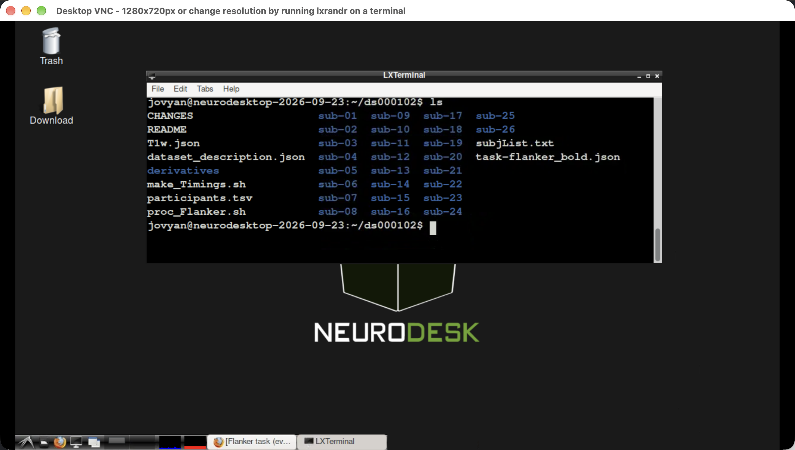
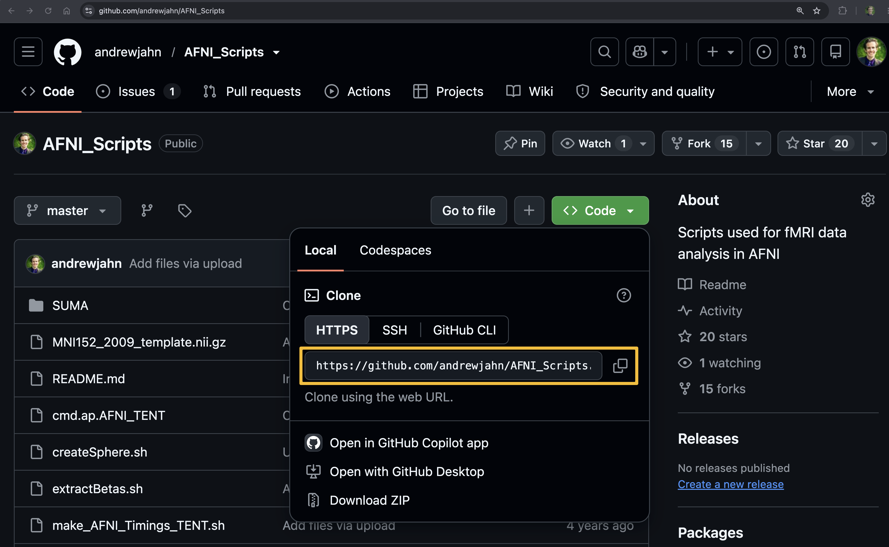

.. _DataLad_01_Neurodesk:

============================
Using DataLad with Neurodesk
============================

-----------
  
Demonstration with Neurodesk
****************************

To demonstrate how to use DataLad, Neurodesk is a robust analysis platform which already comes pre-installed with the software package, as well as many other neuroimaging analysis packages as well. To download and install Neurodesk, follow the instructions `on their website <https://neurodesk.org/>`__, or review the :ref:`Neurodesk page <Neurodesk_Overview>` available in another part of this e-book. The advantages of Neurodesk, in addition to already having DataLad and other essential software installed automatically for you, removes any of the issues with paths and dependencies that you may encounter with your customized personal computer setup. You can also easily move the results from the Neurodesk environment to your local machine through a portal directory called **neurodesktop-storage** that is created in your home directory when you install Neurodesk.

When you create a new Neurodesk instance, click on the computer screen icon in the lower left corner of the new window that appears. This will open a Terminal, in which you can type "datalad", which should be installed.

Once you find a suitable dataset on `OpenNeuro <https://openneuro.org>`__, click on the Download tab and see what the URL is for downloading the dataset using datalad. Then copy and paste that line of code into your Neurodesk terminal; for example, to download the Kelly et al. (2008) Flanker dataset, the code might be something like this:

::

   datalad install https://github.com/OpenNeuroDatasets/ds000102.git

Running this code in Neurodesk will download the dataset structure from OpenNeuro, but without downloading any of the actual data yet. If you navigate to the newly created ``ds000102`` directory and type ``ls``, you will see something like this:

Note that you cannot view or manipulate any of the files using the usual commands, like fsleyes to view the images, or 3dcalc to take the average of two functional datasets. This is because the data has not been downloaded yet; all we have is a skeleton showing us where the data would be, and in what folder.

To download the data, we will use datalad's ``get`` function. For example, if we navigate to the directory ``sub-10/func``, we can download all of the data in that folder by typing:

::

  datalad get *

In which the wildcard ``*`` will download every available file in the directory. If anything else has been moved into the directoy in the meantime, such as a text file that you created, datalad will display an error for those unknown files, but will work for all of the others.

Moving to a higher level of the directory tree, we can navigate to the ``ds000102`` directory and type something like:

::

  datalad get sub-10

Which will download any remaining files in any of the sub-directories of ``sub-10``. Similar commands can be used to download one file at a time, multiple files at a time, an entire subject, or the entire directory in one go. This flexibility is what makes DataLad so powerful, and which also makes it an effective teaching tool; we don't have to download an entire dataset, but can rather see the entire structure and then pick and choose what we want to analyze.

Downloading Code and Scripts for Analysis
*****************************************

Another feature of DataLad is the ability to download a repository from Github; for example, we might have a repository of code for analyzing a given dataset, and we either want to download the entire repository or just a subset of the scripts.

For this dataset, I have already created a repository with AFNI scripts to analyze the Flanker dataset. The code is located on my Github page under `https://github.com/andrewjahn/AFNI_Scripts <https://github.com/andrewjahn/AFNI_Scripts>`__, and clicking on the ``Code`` button reveals different options for how to download the repository. 

The default button that is selected, ``HTTPS``, contains the Github URL that you can use with datalad; we will then copy and paste that link into our Neurodesk terminal:

::

   datalad install https://github.com/andrewjahn/AFNI_Scripts.git

Which will download the directory skeleton, just like it did with the neuroimaging data. To download the code and use it, we would then type:

::

  get AFNI_Scripts

At that point, we would use the same steps as we did in the :ref:`AFNI tutorial <AFNI_Overview>`; that is, we would convert the timing files using the script ``make_Timings.sh`` and then preprocess and model the dataset using ``proc_Flanker.sh``:

::

  cp AFNI_Scripts/make_Timings.sh .
  cp AFNI_Scripts/proc_Flanker.sh .
  bash make_Timings.sh
  tcsh proc_Flanker.sh

Summary
*******

You have now learned how to use DataLad to both download a dataset from OpenNeuro, and how to download a code repository from Github to analyze the dataset. In the next tutorials, we will learn some other features of DataLad, including how to populate a new dataset and how to use it for version control.

Video 
*****

For a video demonstration of how to use datalad to download and analyze the Flanker dataset, click `here <https://youtu.be/WvGrUeJh9qA>`__.
