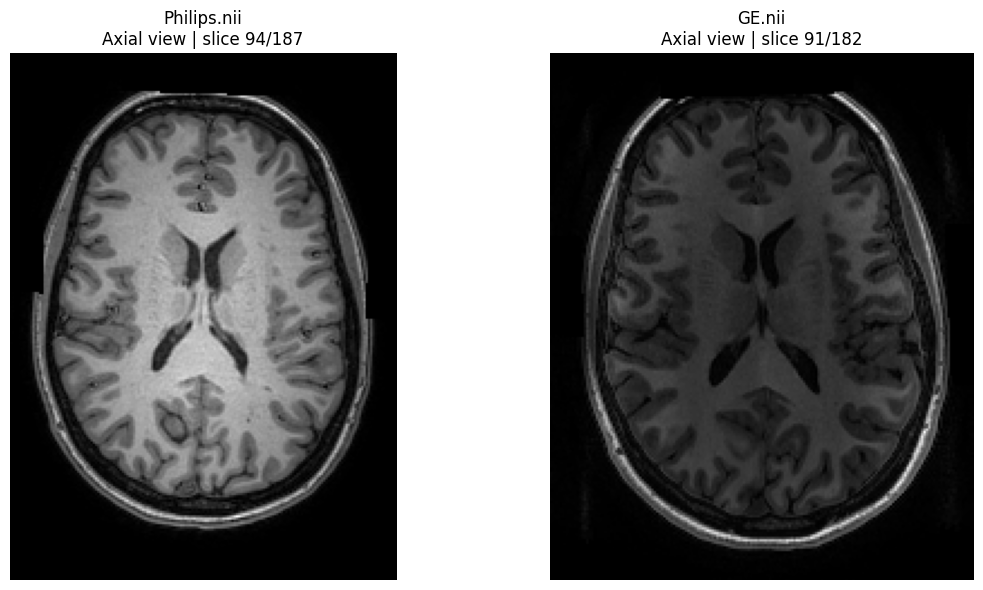

.. _ScanHarm_Overview:

=====================================================================================
Data harmonization for neuroscientific research: Theory, challenges, and applications
=====================================================================================

*Why the same brain looks different on two scanners, and what to do about it.*

   The same participant, scanned with closely matched T1-weighted protocols on a Philips (left) and a GE (right) scanner, from the `ON-Harmony travelling-heads study <https://doi.org/10.1038/s41597-025-04822-2>`__. Same brain, different image. The differences you see here end up in every volume, thickness and model you compute from these scans.

Overview
--------

Multisite studies give us larger and more diverse samples, but every scanner leaves its own fingerprint on the data. This chapter takes you from seeing that fingerprint, through measuring and removing it, to understanding which is the best tool for each problem.

The chapter is based on the **OHBM 2026 Educational Course "Data harmonization for neuroscientific research: Theory, challenges, and applications"**. The full course material (notebooks, data and solutions) is in the `course repository <https://github.com/N-Nieto/OHBM2026_Educational_course_harmonization/tree/main>`__.

.. admonition:: Who is this chapter for?
   :class: note

   Anyone who analyses neuroimaging data from more than one scanner or site. You will get the most out of it if you know:

   - basic Python, to follow the code snippets (see :doc:`/PythonForNeuroimagers/PythonForNeuroimagers_Overview`);
   - linear regression and hypothesis tests (see :doc:`/Stats/Stats_Overview`);
   - machine learning and cross-validation (see :doc:`/ML/ML_Overview`).

Learning Objectives
-------------------

By the end of this chapter, you will be able to:

- **Diagnose** site effects in multisite neuroimaging data, from raw images to derived measures
- **Measure** them with reliability metrics and tests for additive and multiplicative batch effects
- **Evaluate** harmonization methods, from simple regression and ComBat, to more complex and explain why ComBat also corrects differences in variance
- **Recognize** when location-scale models fails and know which extensions target each case (ComBat-GAM, CovBat, longitudinal ComBat)
- **Integrate** harmonization into machine learning pipelines without leaking information, and correctly report performance metrics 
- **Understand** the other alternatives: Image Quality Metric (IQM) harmonization, image-level harmonization and normative modelling

Chapter Roadmap
---------------

The chapter has four blocks, each built around one question. Click a block to see its pages:

1. :ref:`Seeing the problem <ScanHarm_Block1>`: can I see site effects, and do they change my data?
2. :ref:`Measuring and characterizing site effects <ScanHarm_Block2>`: can I put a number on site effects? Are all site effect the same?
3. :ref:`Location-Scale models in depth <ScanHarm_Block3>`: Is regression enough to remove Effects of Site? how does ComBat work, when does it fail, and how do I use it with machine learning?
4. :ref:`Beyond Location-Scale models <ScanHarm_Block4>`: what can I use when site labels and location-scale models are not enough?

Chapter Contents
----------------

.. _ScanHarm_Block1:

Block 1 · Seeing the problem
~~~~~~~~~~~~~~~~~~~~~~~~~~~~

The first step in any harmonization journey is to see the problem. We open with real images from the same participant scanned on different scanners, then simulate multi-site data to see how scanner differences change distributions and statistics.

Questions we answer:

- What exactly is an Effect of Site (EoS), and where does it come from?
- If we scan the same brain on two different scanners, can we see the difference with the naked eye?
- How do these scanner-driven differences alter the distributions and statistical properties of the data?
- And, most importantly: do we truly need harmonization, or can we simply ignore the problem?

Pages in this block:

.. toctree::
   :maxdepth: 1
   :titlesonly:

   course_material/B1_N1_Intro_To_Eos
   course_material/B1_N2_Simulated_example_of_Eos

.. admonition:: Key takeaway
   :class: tip

   Even with matched protocols, the same brain gives different images and different volumes on different scanners. In pooled data, these differences can mimic or hide biology.

.. _ScanHarm_Block2:

Block 2 · Measuring and characterizing site effects
~~~~~~~~~~~~~~~~~~~~~~~~~~~~~~~~~~~~~~~~~~~~~~~~~~~

Once you know site effects exist, the next task is to measure them. We shift from intuition to quantification: how to diagnose the severity of site-related bias, how to remove it with regression and with ComBat, and how to judge whether a method has actually worked.

Questions we answer:

- Is it possible to put a number on the effect of site?
- How deeply is my data contaminated by scanner-driven variance?
- Is there a single metric that tells me everything I need to know, or do we need a panel of complementary checks?
- What does regression remove, and what does it leave behind?

Pages in this block:

.. toctree::
   :maxdepth: 1
   :titlesonly:

   course_material/B2_N1_HarmonisationEvaluation
   course_material/B2_N2_SiteRegression_forHarmonisation
   course_material/B2_N3_Regression_versus_ComBat_harmonisation

.. admonition:: Key takeaway
   :class: tip

   Measure before and after harmonizing. Regression removes shifts in the mean (additive effects); ComBat also corrects differences in variance (multiplicative effects).

.. _ScanHarm_Block3:

Block 3 · Location-Scale models in depth
~~~~~~~~~~~~~~~~~~~~~~~~~

ComBat is the workhorse of neuroimaging harmonization. We move from its model to its assumptions, and from what it does well to where it breaks. Along the way we point to the extensions built for each weakness (ComBat-GAM for nonlinear effects, CovBat for covariance, longitudinal ComBat for repeated scans). We keep a special eye on machine learning, where harmonization must coexist with cross-validation.

Questions we answer:

- What is the mathematical logic behind ComBat?
- What assumptions does it make about the data, and what happens when those assumptions are violated?
- Can ComBat be applied universally, or are there situations where it should be avoided?
- How does class imbalance across sites distort ComBat's behavior?
- How can ComBat be integrated safely into a machine-learning pipeline without leaking information?

Pages in this block:

.. toctree::
   :maxdepth: 1
   :titlesonly:

   course_material/B3_N0_ComBat_applications
   course_material/B3_N1_ComBat_limitations
   course_material/B3_N2_EoS_in_ML
   course_material/B3_N3_Metrics_by_Site
   course_material/B3_N4_ComBat_In_Imbalance_Classes

.. admonition:: Key takeaway
   :class: tip

   ComBat is only as good as its model: nonlinear effects, confounding and continuous scanner variation break it. When classes are unbalanced across sites, a classifier can learn the site instead of the biology, so report performance per site.

.. _ScanHarm_Block4:

Block 4 · Beyond Location-Scale models
~~~~~~~~~~~~~~~~~~~~~~~

ComBat is not the end of the story. In this final block we look at some alternative methods that treat site effects in different ways: by using Image Quality Metrics (IQMs) to complement (or replace) site labels, by harmonizing the images themselves, and by using normative models. We close with a short map of image-level and deep-learning tools you may meet next.

Questions we answer:

- Do all images from the same site share the same site effect?
- Can IQMs better characterize the site to improve harmonization?
- Can we harmonize the images themselves, before extracting any measure?
- How can a normative model harmonize data from sites it has never seen?

Pages in this block:

.. toctree::
   :maxdepth: 1
   :titlesonly:

   course_material/B4_N1_IQM_Harmonisation_Light
   course_material/B4_N2_HarmoniseImages
   course_material/B4_N3_Normative_Modelling

.. admonition:: Key takeaway
   :class: tip

   Site effects can also be modelled through IQMs, corrected in the images themselves, or absorbed by a normative model that maps data from new sites onto a common reference.

Run It Yourself
---------------

.. admonition:: Notebooks, solutions and videos
   :class: tip

   Every page in this chapter comes from a Jupyter notebook in the `course repository <https://github.com/N-Nieto/OHBM2026_Educational_course_harmonization/tree/main>`__. You can:

   - **Run online, no installation:** `launch the notebooks on Binder <https://mybinder.org/v2/gh/N-Nieto/OHBM2026_Educational_course_harmonization/HEAD>`__ (can take a few minutes to load).
   - **Run locally:** clone the repository and follow the instruction to install the dependencies.
   - **Videos:** `recordings by Gaurav Bhalerao <https://drive.google.com/drive/folders/1O_Hf0MwO2VIfAz-8lEe5vk8t5LXRDX9x?usp=sharing>`__ cover Block 2 (pages 1-3) and Block 4 (pages 1-2).

Authors
-------

This chapter was written by `Nicolás Nieto <https://github.com/N-Nieto>`__ (`✉️ <mailto:n.nieto@fz-juelich.de>`__), `Johanna Bayer <https://github.com/likeajumprope>`__, `Gaurav Bhalerao <https://github.com/gvbhalerao591>`__, `Emma Prevot <https://github.com/emmaprevot>`__ and `Jacob Turnbull <https://github.com/Jake-Turnbull>`__. 
Found an error? Open an issue or a pull request on the book's repository, or email us.

Acknowledgement
---------------

This course was developed as one of the outcomes of OxCIN’s (Oxford University Centre for Integrative Neuroimaging) collaborative work through the Harmonisation Working Group. It was designed by members of the group, including both internal and external collaborators, and was presented at OHBM 2026 annual meeting. We are grateful to the other members of the Harmonisation Working Group for their regular contributions to discussions and for helping shape the broader collaborative context of this work. Additionally, this work was supported by the Rosetrees Trust and the NIHR Oxford Health Biomedical Research Centre (NIHR203316). The views expressed are those of the author(s) and not necessarily those of the NIHR or the Department of Health and Social Care. The Centre for Integrative Neuroimaging was supported by core funding from the Wellcome Trust (203139/Z/16/Z and 203139/A/16/Z).

This course was also supported by the EBRAIN-Health Research Infrastructures Grant (101058516), the Institute of Neurosciences and Medicine – Brain and Behaviour (INM-7) at Forschungszentrum Jülich (FZJ), and Heinrich Heine University Düsseldorf (HHU).

