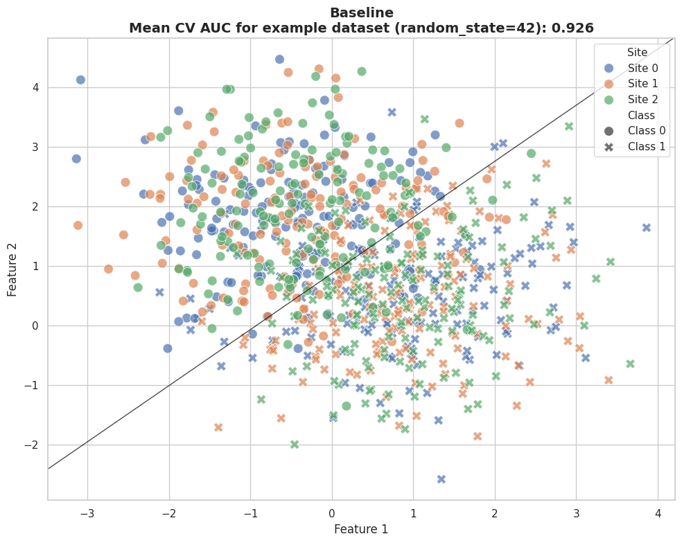
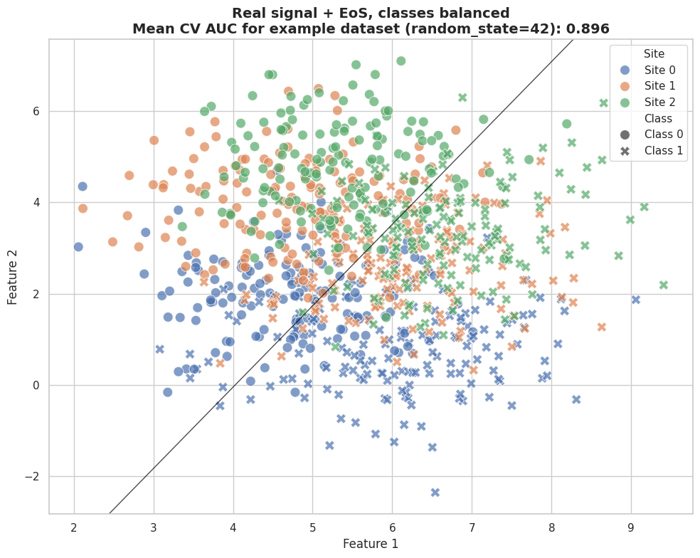
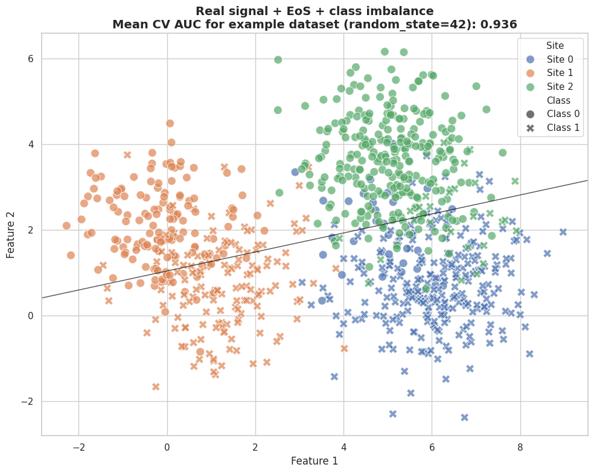
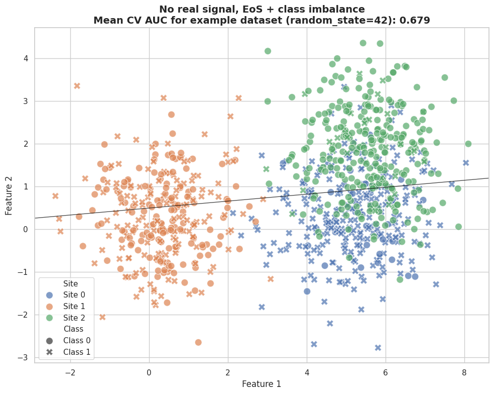
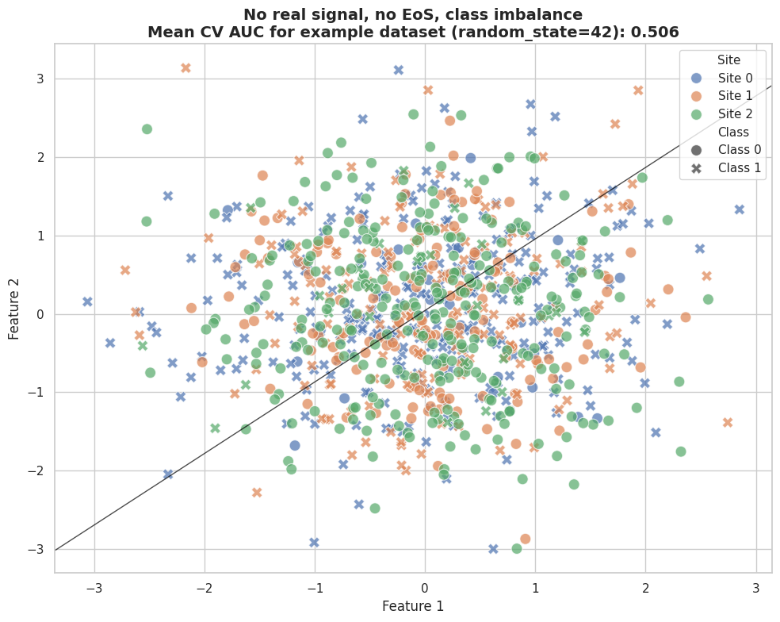

.. _ScanHarm_B3_N2:

================================
Site Effects in Machine Learning
================================

.. include:: ../_wrap_tables.inc

.. admonition:: Run this page yourself
   :class: note

   Notebook: `B3_N2_EoS_in_ML.ipynb <https://github.com/N-Nieto/OHBM2026_Educational_course_harmonization/blob/main/notebooks/block03/B3_N2_EoS_in_ML.ipynb>`__ ·
   Solution: `B3_N2_EoS_in_ML_solutions.md <https://github.com/N-Nieto/OHBM2026_Educational_course_harmonization/blob/main/solutions/block03/B3_N2_EoS_in_ML_solutions.md>`__

The effects of site (EoS) can have two opposite effects on a machine learning (ML) pipeline:

- They can **hinder** the real signal. The EoS then acts as **noise**: the model has a harder time finding the true signal, so removing the EoS should **improve** performance, because the signal-to-noise ratio improves.
- They can **confound** the real signal. The model can then **use** the EoS as a **shortcut** to *spuriously* improve its performance: the predictions are based on the site, not on biology. Removing the EoS should *reduce* performance. This usually happens when the classes are imbalanced across sites, for example when most patients come from one site and most controls from another.

Real data usually mix both effects, which makes EoS hard to diagnose. On this page we vary three factors and watch what they do to a classifier: the strength of the real signal, the strength of the EoS, and the class imbalance across sites. If you are new to classifiers and cross-validation, start with :doc:`/ML/ML_Overview`.

The Simulation
--------------

All scenarios use the same set-up: 900 subjects in 3 sites (300 per site), 2 features so we can plot them, a logistic regression classifier and stratified 10-fold cross-validation. The data come from ``make_multisite_classification`` in `uniharmony <https://pypi.org/project/uniharmony/>`__:

.. code:: python

   from sklearn.model_selection import cross_val_score
   from uniharmony.datasets import make_multisite_classification

   X, y, sites = make_multisite_classification(
       n_samples=900,
       n_sites=3,
       n_features=2,
       signal_type="blobs",
       signal_strength=2,          # real signal (0.001 = none)
       site_effect_strength=7,     # effect of site (0 = none)
       site_effect_type="location",
       # one [proportion of Class 0, proportion of Class 1] list per site
       balance_per_site=[[0.1, 0.9], [0.5, 0.5], [0.9, 0.1]],
       random_state=42,
   )

   # AUC of each of the 10 folds, then the mean
   auc = cross_val_score(clf, X, y, cv=cv, scoring="roc_auc").mean()

For every scenario we report the **AUC, averaged over the 10 folds**. Each scenario is shown for one example dataset (``random_state=42``) and then repeated on 20 other random datasets (seeds 0 to 19), because a single simulated dataset can be misleading.

.. list-table:: The five scenarios
   :header-rows: 1

   * - Scenario
     - Real signal
     - Effect of site
     - Class imbalance
   * - Baseline
     - yes
     - no
     - no
   * - Adding a site effect
     - yes
     - yes
     - no
   * - Adding site-class imbalance
     - yes
     - yes
     - yes
   * - Removing the real signal
     - no
     - yes
     - yes
   * - Removing signal and site effect
     - no
     - no
     - yes

A Baseline Without Site Effects
-------------------------------

First, a problem with real signal, no EoS and the same class balance in every site. We use its performance as the reference for the other scenarios.

   Baseline: real signal, no effect of site, balanced classes. Color is the site, marker is the class, and the line is the classifier's decision boundary.

As no EoS is present, the sites are indistinguishable from each other. The AUC is 0.926 on the example dataset and 0.869 on average over the 20 other datasets.

Adding a Site Effect
--------------------

Now we add a simple location effect (each site shifts the features differently) and keep the classes balanced in every site. We expect the sites to become easy to distinguish visually, but the AUC to **drop**: the classes are balanced in every site, so the site shift says nothing about the class and acts as **noise**.

   Real signal plus a location effect of site, balanced classes.

Across the 20 datasets the AUC drops from 0.869 to 0.774. As expected, the EoS acts as noise and **hinders** the real signal. Try increasing ``site_effect_strength`` in the notebook to see how the model behaves in more extreme cases.

Adding Site-Class Imbalance
---------------------------

Next, we keep the EoS and change the class balance: Site 0 is 90% Class 1, Site 1 stays balanced, and Site 2 is 90% Class 0. The sites remain easy to tell apart, but now the site predicts the class, so the model can use the site shift as a **shortcut**. We expect the AUC to rise.

   Real signal, effect of site and site-class imbalance. Site 0 (blue) is mostly Class 1 (crosses), Site 2 (green) mostly Class 0 (circles).

Across the 20 datasets the AUC rises to 0.885, above the baseline (0.869), although the same EoS lowered it to 0.774 when the classes were balanced. The change is not dramatic here, but we know that this "boost" comes from using the site as a shortcut.

Removing the Real Signal
------------------------

What if there is no real signal at all? A model should then perform at chance (AUC = 0.5). But site and class are still confounded, so the model can rank subjects by their site.

   No real signal, but an effect of site and site-class imbalance. The decision boundary separates sites, not classes.

Even without any real signal, the AUC is well above chance: 0.679 on the example dataset and 0.809 on average. All of it comes from the EoS and the class imbalance; there was no real signal to pick up. Across the 20 datasets the AUC ranges from 0.675 to 0.853, close to the 0.856 limit. How much of the shortcut a linear model can use depends on where the three sites land in feature space.

Removing Both the Real Signal and the Site Effect
-------------------------------------------------

As a sanity check, we remove the EoS as well and keep only the class imbalance. As no signal is present (neither real nor site), the imbalance alone should not change the classification performance.

   No real signal, no effect of site, but class imbalance across sites.

The AUC is at chance (0.506 on the example dataset, 0.508 on average). Class imbalance across sites is only a problem when the sites can be told apart.

Summary Over 20 Datasets
------------------------

.. list-table:: Cross-validated AUC over 20 random datasets (seeds 0 to 19)
   :header-rows: 1

   * - Scenario
     - Mean
     - SD
     - Min
     - Max
   * - Baseline
     - 0.869
     - 0.127
     - 0.555
     - 0.994
   * - Adding a site effect
     - 0.774
     - 0.131
     - 0.532
     - 0.969
   * - Adding site-class imbalance
     - 0.885
     - 0.082
     - 0.720
     - 0.989
   * - Removing the real signal
     - 0.809
     - 0.048
     - 0.675
     - 0.853
   * - Removing signal and site effect
     - 0.508
     - 0.029
     - 0.424
     - 0.543

How to read the table:

- **Baseline → site effect, classes balanced**: the AUC drops (0.87 → 0.77). The EoS acts as noise and hides part of the real signal.
- **Site effect and class imbalance**: the AUC rises above the baseline (0.87 → 0.89). The same EoS that acted as noise when the classes were balanced now helps, because it gives the model a shortcut.
- **No real signal, site effect and imbalance**: the AUC is well above chance (0.81), although there is no real signal at all. All of it is shortcut.
- **No signal, no site effect**: the sanity check, at chance.

The AUC alone cannot tell you which of these situations you are in. What reveals it is comparing scenarios, as here, or knowing how the classes are distributed across sites.

EoS in ML: Noise or Shortcut?
-----------------------------

The effect of site is usually dismissed as nuisance variation: batch effects, instrument drift, or demographic differences we would rather ignore. From an ML perspective, though, EoS is not always noise. Sometimes it is a **shortcut**: an easy feature that predicts the label in this dataset without having anything to do with the biology.

The critical factor is class imbalance across sites. When labels are unevenly distributed between sites, the EoS becomes confounded with the outcome. The model does not learn the pattern you want: it learns which site the sample came from. Performance looks strong, but it is an artifact, and it will not transfer to a new site with a different class balance.

This is not a bug in the algorithm: ML models are greedy and will use every correlation they find. It is a problem of study design. If the site predicts the class better than your features do, the model will take that shortcut every time. Before trusting multi-site performance, check the label distribution per site. Balanced sites reduce confounding; imbalanced sites call for careful stratification, per-site reporting (:ref:`ScanHarm_B3_N3`) and harmonization that takes the target into account (:ref:`ScanHarm_B3_N4`).

.. admonition:: Key takeaway
   :class: tip

   - EoS can hinder or inflate ML performance. A good first step is to check the class balance across sites.
   - Real problems are messier, with more sites, heterogeneous imbalances, more complex site effects, more features and fewer subjects.

Question
--------

After harmonizing the data, how could we tell whether the harmonization removed only the EoS, or also the real signal that is confounded with the sites?

From the performance alone, we cannot. A **drop** in performance after harmonization can mean that we removed real signal, *or* that the model can no longer use the EoS as a shortcut. A **rise** can mean that we removed an EoS that was acting as noise, but then we must be extra careful that no information leaked to the model along the way (see :ref:`ScanHarm_B3_N4`).

Two checks help:

1. **How confounded are site and class?** The stronger the site-class imbalance, the less any method can separate the two, and the more cautious the interpretation must be.
2. **Can the site still be predicted from the harmonized features?** If a classifier can no longer tell the sites apart, this is a good signal, but it says nothing about the real signal.

**Next:** :ref:`ScanHarm_B3_N3` shows how a single overall metric can hide sites where the model does not work at all.
