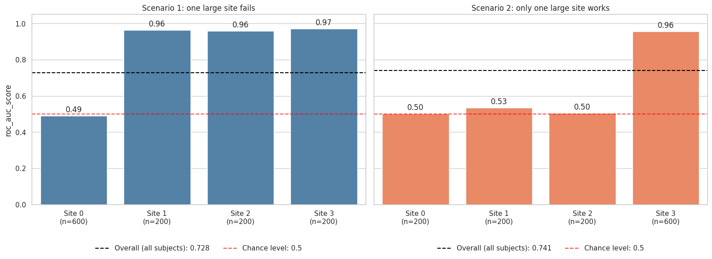

.. _ScanHarm_B3_N3:

==============================
Reporting Performance per Site
==============================

.. include:: ../_wrap_tables.inc

.. admonition:: Run this page yourself
   :class: note

   Notebook: `B3_N3_Metrics_by_Site.ipynb <https://github.com/N-Nieto/OHBM2026_Educational_course_harmonization/blob/main/notebooks/block03/B3_N3_Metrics_by_Site.ipynb>`__ ·
   Solution: `B3_N3_Metrics_by_Site_solutions.md <https://github.com/N-Nieto/OHBM2026_Educational_course_harmonization/blob/main/solutions/block03/B3_N3_Metrics_by_Site_solutions.md>`__

With multi-site data, we need to be careful about how we report performance. An overall metric summarizes the model across all subjects, but it can hide sites where the model does not work at all.

Reporting performance per subgroup is also a common exercise to assess **fairness** in ML: checking that particular groups of subjects (here, sites) are not systematically harmed by the model, and that the reported metrics reflect how the model performs for each of them.

On this page, besides the overall metric, we compute each metric using only the subjects of each site. Importantly, the model is *always* trained on the whole dataset (all sites together); we only disaggregate the metric calculation by site.

The Set-up
----------

- We simulate **good** sites, where the features carry information about the class, and **bad** sites, where they do not. All sites come from the same simulated problem and there are **no effects of site**: the feature distributions are identical. In the bad sites we shuffle the class labels, so features and class are unrelated there (think of unreliable diagnoses or unusable scans).
- Each dataset has 10 features and 1,200 subjects. A logistic regression is evaluated with stratified 10-fold cross-validation, so every subject gets an out-of-fold prediction.

The main tool is ``report_metrics_by_site`` from `uniharmony <https://pypi.org/project/uniharmony/>`__. It computes one or several metrics on all subjects (``"overall"``) and inside each site:

.. code:: python

   from sklearn.metrics import balanced_accuracy_score, roc_auc_score
   from sklearn.model_selection import cross_val_predict
   from uniharmony.metrics import report_metrics_by_site

   # out-of-fold probabilities of Class 1, not predicted classes
   proba = cross_val_predict(clf, X, y, cv=cv, method="predict_proba")[:, 1]
   metrics = report_metrics_by_site(
       y, proba, sites, [balanced_accuracy_score, roc_auc_score]
   )

The result is a dictionary with the metric names as keys. For each metric it contains the overall value, followed by the value in each site.

Two Scenarios
-------------

Both scenarios have 1,200 subjects, and in both exactly half of them (600) come from bad sites:

.. list-table::
   :header-rows: 1

   * - Scenario
     - Bad sites (no signal)
     - Good sites (with signal)
   * - 1: one large site fails
     - Site 0: 600 subjects
     - Sites 1 to 3: 200 subjects each
   * - 2: only one large site works
     - Sites 0 to 2: 200 subjects each
     - Site 3: 600 subjects

For the example dataset, ``report_metrics_by_site`` returns:

.. list-table:: AUC overall and per site (example dataset)
   :header-rows: 1

   * - Scenario
     - Overall
     - Site 0
     - Site 1
     - Site 2
     - Site 3
   * - 1: one large site fails
     - 0.728
     - 0.489
     - 0.964
     - 0.958
     - 0.970
   * - 2: only one large site works
     - 0.741
     - 0.503
     - 0.534
     - 0.504
     - 0.957

Looking only at the overall metric, the two scenarios look the same (AUC 0.728 vs 0.741; balanced accuracy 0.703 vs 0.722).

Performance per Site
--------------------

   AUC per site, with the number of subjects per site. Dashed black: overall AUC (all subjects). Dashed red: chance.

As expected, the **bad** sites are at chance (AUC ≈ 0.5) and the **good** sites reach AUC ≈ 0.96. The overall AUC is almost the same in both scenarios, but the site-level picture is opposite: the model works in 3 of 4 sites in Scenario 1, and in only 1 of 4 sites in Scenario 2.

The overall metric weights every *subject* equally, and both scenarios have half of their subjects in bad sites, so it cannot tell them apart. Only the per-site values can.

.. admonition:: Key takeaway
   :class: tip

   - An overall metric can hide sites where the model does not work, and it cannot tell "one large failing site" from "many small failing sites".
   - Reporting metrics per site is a good first step (but not the only one) to uncover these hidden biases.
   - Per-site values from small sites are unstable and less reliable. Still, it is better to know that a site's AUC is unreliable than to assume that the model works well there.

Questions
---------

**How is it possible that both scenarios have a similar overall performance?**

The overall metric is computed over all subjects together, so every subject counts the same, wherever it comes from. In both scenarios exactly half of the subjects (600 of 1,200) come from sites without signal, so the model works for the same share of subjects and the overall AUC is similar (0.728 vs 0.741). The site-level picture is opposite, and only the per-site metrics reveal it. If we had only reported the overall performance, we could not have uncovered this. Report the per-site metrics together with the number of subjects of each class in each site, and read them site by site.

**The discrimination ability of the model is almost the same in both scenarios. Would you recommend using it in Site 0?**

No. We should not use a model to make important decisions in a site where we know it does not work. Once a per-site analysis uncovers such a bias, the next step is to find out *why* the model fails there. In this simulation we removed the real signal from the bad sites on purpose; in real data, the biological signal can also be masked by a strong EoS, or the labels of that site can be unreliable.

**No EoS was simulated here. What could happen if different EoS were present in different sites?**

As we saw in :ref:`ScanHarm_B3_N2`, it depends not only on the EoS but also on the class imbalance across sites.

- If the classes are balanced in every site, the EoS acts as noise. Sites with a strong EoS become noisier and can behave like "bad" sites.
- If the classes are imbalanced across sites, the EoS becomes informative about the class. For example, with one big site of healthy controls and many small sites of patients, the model can learn to recognize the control site instead of the disease, and the overall metric looks good. In the extreme case, from the model's perspective, classifying the site is the same as classifying the target.

**Next:** :ref:`ScanHarm_B3_N4` asks what happens when we harmonize data in which site and class are confounded.
