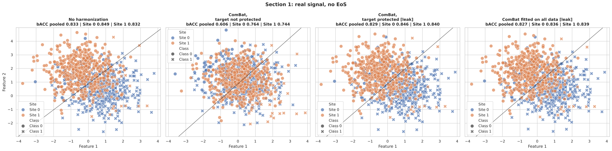
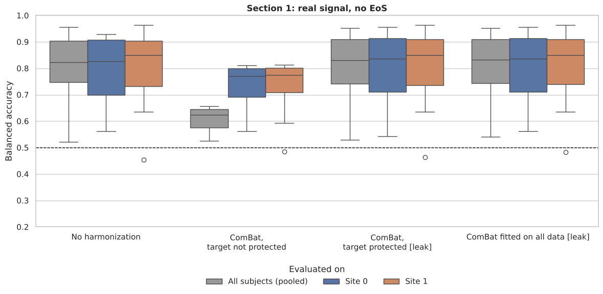
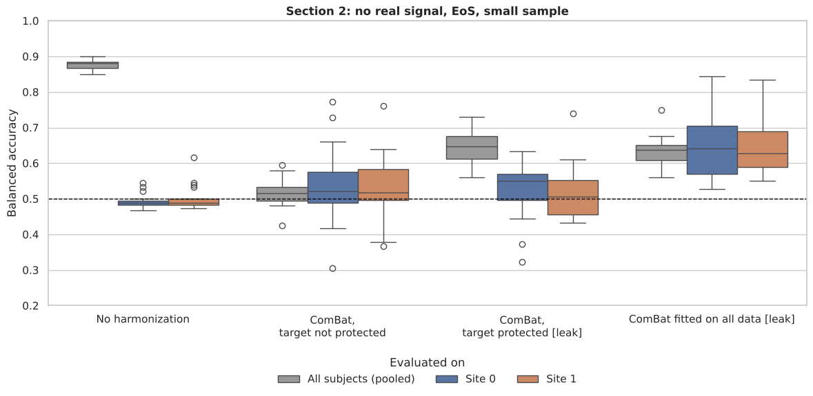

.. _ScanHarm_B3_N4:

==================================
ComBat with Site-Class Imbalance
==================================

.. include:: ../_wrap_tables.inc

.. admonition:: Run this page yourself
   :class: note

   Notebook: `B3_N4_ComBat_in_imbalance_classes.ipynb <https://github.com/N-Nieto/OHBM2026_Educational_course_harmonization/blob/main/notebooks/block03/B3_N4_ComBat_in_imbalance_classes.ipynb>`__ ·
   Solution: `B3_N4_ComBat_in_imbalance_classes_solutions.md <https://github.com/N-Nieto/OHBM2026_Educational_course_harmonization/blob/main/solutions/block03/B3_N4_ComBat_in_imbalance_classes_solutions.md>`__

Site-class imbalance occurs when the classes are distributed differently in each site. The extreme case is one site that collects all the patients and another that collects all the healthy controls.

In this case the effect of site (EoS) is correlated with the target. Location-scale models such as ComBat (see :ref:`ScanHarm_B3_N0`) cannot separate the EoS from the true signal unless we pass the target as a covariate, that is, unless we **protect** it. Even when there is no EoS at all, the class difference looks like a site difference to ComBat, and ComBat will try to remove it. This is the machine learning (ML) side of the confounding problem discussed in :ref:`ScanHarm_B3_N1` (Step 2).

Under the right assumptions, protecting the target is feasible in a statistical analysis, where all labels are known. In an ML pipeline the labels of the test subjects are unknown: they are what we want to predict. On this page we simulate this situation, apply NeuroComBat (the ComBat implementation in `uniharmony <https://pypi.org/project/uniharmony/>`__) in several ways, and evaluate a simple classifier. It is a simplified, simulated version of the problem studied by Nieto et al. (2026) [1]_.

Pipelines
---------

.. list-table::
   :header-rows: 1
   :widths: 26 26 30 18

   * - Pipeline
     - ComBat is fitted on
     - To harmonize a test subject, ComBat needs
     - Valid in ML?
   * - No harmonization
     - —
     - —
     - yes
   * - ComBat, target not protected
     - training folds
     - its site
     - yes
   * - ComBat, target protected [leak]
     - training folds, with the class as covariate
     - its site **and its true label**
     - **no** (leak)
   * - ComBat fitted on all data [leak]
     - **all subjects**, with their labels, before the split
     - — (already harmonized)
     - **no** (leak)

The "target protected" pipeline shows where the leak comes from. Inside each fold:

.. code:: python

   from uniharmony.combat import NeuroComBat

   y_col = y.reshape(-1, 1)  # ComBat expects covariates as a column
   combat = NeuroComBat().fit(
       X[train], sites[train], categorical_covariates=y_col[train]
   )
   X_train_h = combat.transform(
       X[train], sites[train], categorical_covariates=y_col[train]
   )
   # LEAK: to transform the test subjects, ComBat also needs their labels
   X_test_h = combat.transform(
       X[test], sites[test], categorical_covariates=y_col[test]
   )

How We Measure Performance
--------------------------

We use 10-fold cross-validation; ComBat is fitted inside each training fold, except in the "fitted on all data" pipeline. We report the **balanced accuracy (bACC)**, the mean of sensitivity and specificity, computed from the predicted classes (Class 1 when the predicted probability is at least 0.5):

- **Pooled bACC**: on all subjects together.
- **bACC in each site**: the same out-of-fold predictions, from the same model trained on all sites, evaluated on the subjects of Site 0 and of Site 1 separately (as in :ref:`ScanHarm_B3_N3`). The two values are shown side by side and never averaged.

Why look at each site? If the pooled bACC is high while every site is at chance (0.5), the model is only telling the sites apart. 

In both sections, 90% of the subjects in Site 0 belong to Class 1 and 90% of the subjects in Site 1 belong to Class 0 (``balance_per_site=[[0.1, 0.9], [0.9, 0.1]]``, one [Class 0, Class 1] list per site). Each scenario is shown for one example dataset and repeated on 20 other random datasets.

Section 1: Real Signal, No EoS
------------------------------

We simulate 1,000 subjects in two sites (Site 0: 50 Class 0 / 450 Class 1; Site 1: 450 / 50) with a real signal (2 features) and **no** EoS. What should we expect?

- Without harmonization, the classifier works, and the pooled bACC agrees with the bACC in each site (there is no EoS).
- ComBat without the target sees two sites with different means. It does not know that the difference comes from the classes, so it removes it, and the real signal with it.
- ComBat with the target protected keeps the class difference.

   Section 1, example dataset: real signal, no EoS, site-class imbalance. Color is the site, marker is the class, and the line is the decision boundary. Titles give the pooled bACC and the bACC in each site. Click the figure to enlarge it.

.. list-table:: Balanced accuracy, Section 1: example dataset (mean over 20 datasets in brackets)
   :header-rows: 1

   * - Pipeline
     - Pooled
     - Site 0
     - Site 1
   * - No harmonization
     - 0.833 (0.809)
     - 0.849 (0.801)
     - 0.832 (0.804)
   * - ComBat, target not protected
     - 0.606 (0.610)
     - 0.764 (0.740)
     - 0.744 (0.740)
   * - ComBat, target protected [leak]
     - 0.829 (0.811)
     - 0.846 (0.805)
     - 0.840 (0.807)
   * - ComBat fitted on all data [leak]
     - 0.827 (0.811)
     - 0.836 (0.805)
     - 0.839 (0.808)

75.
   :width: 90%

   Section 1: balanced accuracy over 20 datasets, pooled and in each site. Dashed line: chance.

What happened?

- **ComBat, target not protected** removes the real signal: the pooled bACC drops from 0.833 to 0.606 (0.81 → 0.61 across the 20 datasets). ComBat moved the two sites on top of each other. So the bACC also drops inside each site, from 0.849 to 0.764 in Site 0 and from 0.832 to 0.744 in Site 1 (0.80 → 0.74 across datasets).
- **ComBat, target protected** keeps the signal (0.829), but only because ComBat was given the **true labels of the test subjects** to harmonize them. In a real ML application these labels are unknown, so this pipeline cannot be used.
- **ComBat fitted on all data [leak]** gives almost the same result (0.827; 0.81 across datasets). With 1,000 subjects and only 2 features, this leak barely changes the performance. Section 2 shows when it does.

Section 2: No Real Signal, EoS, Small Sample
--------------------------------------------

Where does leakage really inflate performance? Leakage matters most with few subjects and many features, which is common in neuroimaging. Here we simulate:

- no real signal: the features carry no information about the class;
- a location EoS (strength 5);
- the same site-class imbalance (Site 0: 10 Class 0 / 90 Class 1; Site 1: 90 / 10);
- 200 subjects (100 per site) and 20 features.

Any balanced accuracy above 0.5 is an artifact. With 20 features we cannot plot the data, so we show box plots over the 20 datasets. Each site has only 10 subjects of its minority class, so per-site values from a single dataset are noisy, and we compare means over the 20 datasets.

   Section 2: balanced accuracy over 20 datasets, pooled (grey), Site 0 (blue) and Site 1 (orange). Dashed line: chance.

.. list-table:: Balanced accuracy, Section 2: mean ± SD over 20 datasets
   :header-rows: 1

   * - Pipeline
     - Pooled
     - Site 0
     - Site 1
   * - No harmonization
     - 0.876 ± 0.014
     - 0.493 ± 0.019
     - 0.501 ± 0.034
   * - ComBat, target not protected
     - 0.518 ± 0.038
     - 0.541 ± 0.105
     - 0.528 ± 0.098
   * - ComBat, target protected [leak]
     - 0.640 ± 0.044
     - 0.522 ± 0.076
     - 0.518 ± 0.074
   * - ComBat fitted on all data [leak]
     - 0.634 ± 0.041
     - 0.645 ± 0.085
     - 0.644 ± 0.075

What happened?

- **No harmonization**: pooled bACC 0.88, while each site is at chance (0.49 and 0.50). The model only recognizes the site: shortcut learning, as in :ref:`ScanHarm_B3_N2`.
- **ComBat, target not protected**: pooled bACC at chance (0.52; sites 0.54 and 0.53). The shortcut is removed; there was no real signal to lose.
- **ComBat, target protected [leak]**: pooled bACC 0.64, sites 0.52. With a 90% / 10% imbalance, site and class are almost the same variable, so ComBat attributes part of the site difference to the class and keeps it. Even with the test labels, the model still uses the site.
- **ComBat fitted on all data [leak]**: pooled 0.63 **and** 0.64 in each site. The test labels were used to build the features, so the "signal" is now present inside each site too. This is a more severe leak, and looking at the sites no longer catches it.

The last pipeline is a common mistake that ML pipelines must avoid: harmonizing the whole dataset once, then running cross-validation on the harmonized data, is a severe form of data leakage.

.. admonition:: Key takeaway
   :class: tip

   - With site-class imbalance, location-scale methods such as NeuroComBat remove the real signal unless the target is protected as a covariate.
   - Protecting the target is possible in a statistical analysis, where all labels are known. In an ML pipeline, ComBat must be fitted on the training data only, and protecting the target would also need the labels of the test subjects, which are unknown. Standard ComBat therefore cannot protect the target in an ML pipeline; this needs dedicated approaches such as PrettYharmonize (below).
   - Never harmonize the whole dataset with the labels before cross-validation: with few subjects and many features this creates performance from nothing.

Question
--------

What do you think would happen in Section 1 if an EoS were also simulated?

With site-class imbalance, each site is mostly one class. An EoS shifts all the subjects of a site in the same direction, so the shift ends up aligned with the class. The EoS and the class become **confounded**: from the data alone, a difference between the sites can be either the scanner or the biology.

- **No harmonization**: the model can now use two sources of information, the real signal and the site shift as a shortcut. The pooled bACC goes **up**, because recognizing the site already predicts most of the labels (as in :ref:`ScanHarm_B3_N2`). Inside each site the shift does not help, and the decision boundary is no longer placed for the real signal, so the bACC in each site goes **down**. Pooled and per-site values disagree: a warning sign.
- **ComBat, target not protected**: ComBat removes the difference between the sites. It cannot tell which part comes from the scanner and which from the classes, so it removes both, the EoS **and** the real signal. The result is the same as in Section 1 without EoS.
- **ComBat, target protected [leak]**: with the class as covariate, ComBat estimates the site effect separately from the class effect. It removes the EoS and keeps the signal, so the results go back to those of Section 1 without EoS. But it needs the true labels of the test subjects, so it cannot be used.
- **ComBat fitted on all data [leak]**: same result here, with an even larger leak. With 1,000 subjects and 2 features this barely changes the numbers, but the pipeline is still invalid.

When the classes are imbalanced across sites, the EoS and the class cannot be separated without knowing the labels. Inside an ML pipeline this leaves two bad options for standard ComBat: lose the signal (target not protected) or leak the test labels (target protected).

Want to Dig Deeper?
-------------------

Nieto et al. (2026) [1]_ evaluate no harmonization, leakage-prone and leakage-free harmonization schemes on controlled benchmark datasets and on real MRI and clinical ICU data. They introduce **PrettYharmonize**, which integrates ComBat-based harmonization into ML pipelines without using the test labels.

- PrettYharmonize: https://github.com/juaml/PrettYharmonize
- Code to replicate the paper: https://github.com/juaml/harmonize_project

.. [1] Nieto, N., Eickhoff, S. B., Jung, C., et al. (2026). Impact of leakage on data harmonization in machine learning pipelines in class imbalance across sites. *Neurocomputing*, 680, 133146. https://doi.org/10.1016/j.neucom.2026.133146

**Next:** Block 4 looks beyond location-scale models, starting with :ref:`ScanHarm_B4_N1`.
